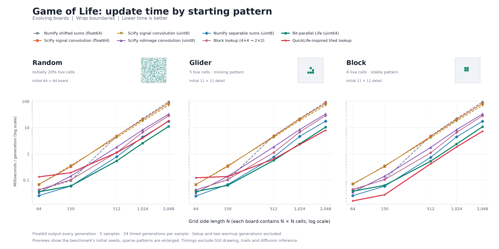

# Conway's Game of Life

This is a Python implementation of Conway's Game of Life. The Game of Life is a cellular automaton devised by the British mathematician John Horton Conway in 1970. It's a zero-player game, meaning that its evolution is determined by its initial state, requiring no further input. One interacts with the Game of Life by creating an initial configuration and observing how it evolves.

## Web demos

A browser-native Game of Life and a Belousov–Zhabotinsky visualizer live in `docs/`. Open `docs/index.html` locally or [view it online](https://sgt1796.github.io/Game_of_life/).


## Rules

The universe of the Game of Life is a two-dimensional orthogonal grid of square cells, each of which is in one of two possible states, alive or dead. Every cell interacts with its eight neighbors, which are the cells that are horizontally, vertically, or diagonally adjacent.

At each step in time, the following transitions occur:

1. **Birth**: A dead cell with exactly three live neighbors becomes a live cell.
2. **Death by Isolation**: A live cell with fewer than two live neighbors dies.
3. **Death by Overcrowding**: A live cell with more than three live neighbors dies.
4. **Survival**: A live cell with two or three live neighbors continues to live.

The initial pattern constitutes the 'seed' of the system. The first generation is created by applying the above rules simultaneously to every cell in the seed—births and deaths occur simultaneously.

## Implementation

The implementation uses Python libraries NumPy for numerical operations and Matplotlib for visualization. `Game_of_Life.py` owns the simulation controller, including grid initialization, generation updates, seeding, reset/clear, pause/resume, and boundary selection. `Game_of_Life_UI.py` contains the Matplotlib layout, controls, event handlers, and fading/color rendering. The numerical engines remain in `life_engines.py`. Launch the desktop application with `python Game_of_Life.py run`.

## Faster Life updates

A combined, persistent QuickLife-style core is now available with
`--life-engine quicklife`. It combines 4-by-8 packed slices, the block lookup,
alternating alignment, two generation buffers, and dirty-tile skipping. Both
views use its persistent state for edits and updates. Read the
[engine design, remaining gaps, and shared benchmarks](benchmarks/README.md#quicklife-implementation).

```powershell
& '..\StreamDiffusion\.venv\Scripts\python.exe' '.\Game_of_Life.py' streamdiffusion --life-engine quicklife
```

`next_gen(grid, boundary_mode, method="auto")` now uses byte-based separable
neighborhood sums for small boards and 64-bit packed cell updates for boards
with at least 65,536 cells and 128 columns. Each engine accepts binary matrices,
returns a float64 matrix, and preserves wrap/open/fill boundaries.

Choose a method explicitly with `method="dense"`, `"packed"`, `"lookup"`, or `"quicklife"` in
Python, or `--life-engine packed` when launching either view. The lookup engine
uses a cached 64 KiB table that maps every 4-by-4 block to the next central
2-by-2 cells. The packed engine performs neighbor counting on 64 cells per
machine word using bitwise operations. Neither needs SciPy.

All four engines live in `life_engines.py`. To preserve QuickLife's packed state
between generations in Python:

```python
from life_engines import QuickLifeEngine

engine = QuickLifeEngine(grid, boundary="wrap")
engine.step(100)
grid = engine.to_numpy()
```

[Benchmark results and Golly implementation notes](benchmarks/README.md) compare
eight implementations, including QuickLife, on matrices up to 8192-by-8192.
The shared runner measures both fixed-input updates and evolving boards, with
float64 output for every method. These are independent
NumPy implementations of packed-bit and block-lookup techniques, not a full
port of Golly's sparse QuickLife engine or its HashLife algorithm.



The panels compare milliseconds per generation on the same logarithmic y scale
as the individual pattern figures; lower is faster. Each shows
the actual starting pattern; glider and block previews are enlarged. See the
[benchmark tables and individual timing figures](benchmarks/README.md#evolving-board-performance)
for all three patterns. GUI drawing and diffusion inference are excluded.

## Usage

Choose an interface subcommand, then put its options after the command:

```sh
python Game_of_Life.py run --life-engine quicklife
python Game_of_Life.py webui --port 8001 --no-browser
python Game_of_Life.py streamdiffusion --style Cosmic --fps 6
```

`--life-engine` is available in all three subcommands. Web server options belong
to `webui`; model, rendering, and diffusion simulation options belong to
`streamdiffusion`. A subcommand is required: use `run` for the desktop UI, and
replace the former `--webui` and `--streamdiffusion` flags with their command names.
Run `python Game_of_Life.py --help` to list interfaces, or use `run --help`,
`webui --help`, or `streamdiffusion --help` to see that interface's options.

### Luminous Life web UI

Run the luminous perspective interface with the Python simulation core:

```sh
python Game_of_Life.py webui
# Use the persistent QuickLife engine:
python Game_of_Life.py webui --life-engine quicklife
```

The command starts a local server and opens `http://127.0.0.1:8000` in your browser.
Use `--port 8001` to choose another port, or `--no-browser` to open the URL yourself.
Press Ctrl+C in the terminal to stop the server. Only Python and NumPy are needed;
the web view does not import Matplotlib or diffusion dependencies.

Play/pause, single-step, presets, reset, drawing, and erasing use the Python core.
The browser handles the perspective camera, bloom, grid, and fading trails.
`UnboundedGameOfLife` in `Game_of_Life.py` grows the numerical board before cells
reach its edges, preserving the design's unbounded world without wrapping.
`Game_of_Life_Web.py` serves the frontend in `luminous-life/dist/` and translates
HTTP commands into core operations. Each server owns one simulation shared by
its browser tabs. A plain static HTTP server cannot run this connected view.

Run the core and HTTP regression checks with `python -m unittest discover -s tests`.

### Live StreamDiffusion rendering from the numerical grid

The optional renderer passes the NumPy Life matrix and its fading history directly
to StreamDiffusion as a colored RGB image. There is no screen capture and generated
pixels never change the simulation. The original interactive view remains available
with `python Game_of_Life.py run`.

With StreamDiffusion installed beside this repository, run in PowerShell:

```powershell
& '..\StreamDiffusion\.venv\Scripts\python.exe' '.\Game_of_Life.py' streamdiffusion
```

The new window shows the matrix input and live diffusion output side by side.
Choose Bioluminescent, Botanical, or Cosmic; edit the prompt and click Apply prompt.
Draw live cells with the left mouse button, erase with the right, and use Pause,
Reseed, Clear, the boundary selector, and the Life steps/s slider to explore.
Save images writes PNGs to `renders/life/`.

Defaults are a 64-by-64 simulation rendered at 512-by-512, eight Life generations
per second, a fixed seed, and the locally cached `KBlueLeaf/kohaku-v2.1` model with
LCM-LoRA and TinyVAE. Coarser cells and luminous trails give diffusion larger shapes
to interpret. Model loading and inference run in a background thread; only the
latest pending input is kept, so slow inference does not build a frame backlog.
There is some pipeline delay between the two views. Frame-to-frame consistency
and exact visible cell preservation are not guaranteed by image diffusion.

```powershell
# Set a different look, prompt, or simulation resolution.
& '..\StreamDiffusion\.venv\Scripts\python.exe' '.\Game_of_Life.py' streamdiffusion --style Cosmic --grid-size 96 --fps 6

# Render reproducible PNG comparisons without opening a window.
& '..\StreamDiffusion\.venv\Scripts\python.exe' '.\Game_of_Life.py' streamdiffusion --render-frames 4
```

Use `--stream-root 'C:\path\to\StreamDiffusion'` for another installation location.
The diffusion view needs NumPy, Pillow, Tkinter, and the installed StreamDiffusion
dependencies. The original view uses Matplotlib; the Life step does not require SciPy.
Models load offline by default. Add `--allow-download` if the model, LCM-LoRA,
or `madebyollin/taesd` weights are missing from the Hugging Face cache.

Start with `--acceleration none`, which still runs PyTorch on CUDA. Optional
`--acceleration tensorrt` may build engines in `renders/engines/` on first use.
`--t-indices 28 40` selects two stages from the 50-step schedule for an organic
reinterpretation. Try `--t-indices 35 45` to retain more of the source structure,
or `--t-indices 20 35` for a more freely imagined result.
Run `python Game_of_Life.py streamdiffusion --help` for all diffusion options. These options apply to the
diffusion view; the original view retains its existing defaults and controls.

### Running Game of Life

1. **Python Source Code**:
   - To run the game, execute the `Game_of_Life.py` script using Python:
     ```sh
     python Game_of_Life.py run
     ```
   - Or run it in any Python IDE with `run` as the script argument.
   - The script initializes a 150x150 grid with a random distribution of live cells and starts the simulation. Use the interactive controls to adjust settings such as fade rate, cell colors, and seeding ratio.

2. **Executable Version**:
   - An executable version of the game is available for users who do not have a Python environment set up. Simply download and run the executable file.

3. **Webpage Version**:
   - The repository also includes a webpage version (`game_of_life.html`) that provides a comprehensive explanation of the Game of Life, converted from R Markdown files with implementation of Game of Life using R.

