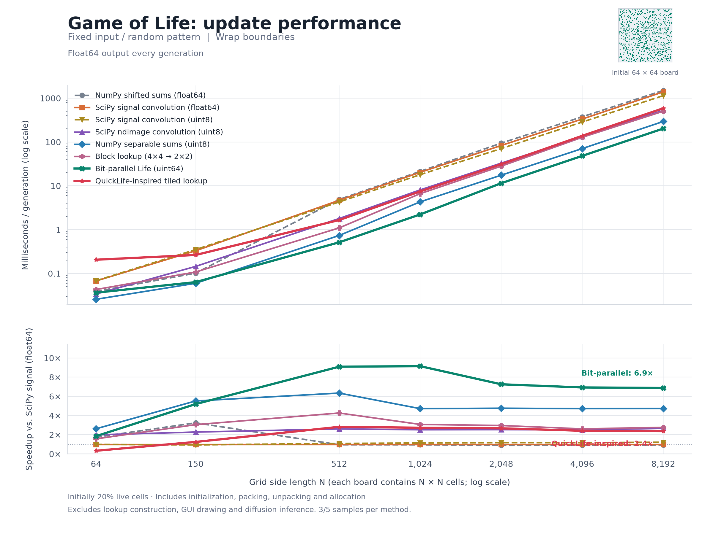
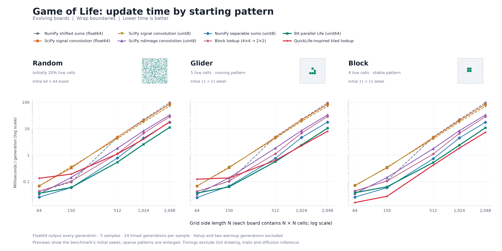

# Life engine benchmarks and Golly investigation

Measured locally on 2026-11-05 with Python 3.12.13, NumPy 2.5.1, and SciPy 1.18.1.
`benchmark_life.py` compares all eight methods in the same runner and saves their
measurements together. Every method produces a float64 matrix each generation.
GUI drawing, fading trails, RGB conditioning, and diffusion inference are excluded.

| Method | Internal representation | Main operation |
|---|---|---|
| NumPy shifted sums (float64) | 8 bytes per cell | Add eight shifted arrays |
| SciPy signal convolution (float64) | 8 bytes per cell | General-purpose 2D convolution |
| SciPy signal convolution (uint8) | 1 byte per cell | Byte-based 2D convolution |
| SciPy ndimage convolution (uint8) | 1 byte per cell | Byte-based image convolution |
| NumPy separable sums (uint8) | 1 byte per cell | Horizontal sums, then vertical sums |
| Block lookup (4×4 → 2×2) | 16-bit neighborhood codes | Look up four output cells together |
| Bit-parallel Life (uint64) | 1 bit per cell during computation | Bitwise neighbor counting |
| QuickLife-inspired tiled lookup | Packed 4-by-8 uint32 slices, two buffers | Block lookup, alternating alignment, dirty 32-by-32 tiles |

The three Golly-inspired methods are independent NumPy implementations in
`life_engines.py`. They do not call Golly's native engine.

## Fixed-input performance by grid size

These measurements time one generation repeatedly from the same binary float64
matrix, initially 20% live. Each call includes input conversion, padding,
initialization, packing, output allocation, and conversion back to float64.
QuickLife uses its stateless `step_quicklife` wrapper here, so its engine setup is
included on every call. Lookup-table construction is warmed up before timing.

Results are medians of five samples (three at 8192). Each sample batches enough
calls to approach 80 ms where practical, capped at 200 calls; the 8192 run uses
a 50 ms target. Every method's output is checked against the original NumPy
float implementation. Timings vary with cache and machine load. Wrap and open
boundaries were tested through 4096; 8192 uses wrap only.



[Download the SVG version](methods-vs-size.svg). The upper panel shows median
milliseconds per generation on logarithmic axes; lower is better. The lower
panel shows speedup relative to SciPy signal convolution; higher is better.
Both panels include all eight methods, including QuickLife.

### Wrap boundary, milliseconds per generation

| Grid | NumPy shifted sums (float64) | SciPy signal convolution (float64) | SciPy signal convolution (uint8) | SciPy ndimage convolution (uint8) | NumPy separable sums (uint8) | Block lookup (4×4 → 2×2) | Bit-parallel Life (uint64) | QuickLife-inspired tiled lookup |
|---|---:|---:|---:|---:|---:|---:|---:|---:|
| 64 x 64 | 0.039 | 0.068 | 0.068 | 0.034 | 0.026 | 0.043 | 0.036 | 0.206 |
| 150 x 150 | 0.102 | 0.330 | 0.351 | 0.145 | 0.060 | 0.108 | 0.064 | 0.264 |
| 512 x 512 | 4.889 | 4.671 | 4.282 | 1.795 | 0.737 | 1.096 | 0.514 | 1.656 |
| 1024 x 1024 | 21.378 | 20.335 | 17.965 | 8.076 | 4.310 | 6.619 | 2.224 | 7.457 |
| 2048 x 2048 | 94.160 | 83.225 | 70.763 | 32.909 | 17.487 | 28.114 | 11.470 | 31.202 |
| 4096 x 4096 | 375.815 | 333.741 | 285.029 | 133.198 | 70.720 | 127.873 | 48.187 | 138.394 |
| 8192 x 8192 | 1499.572 | 1390.107 | 1141.807 | 522.774 | 293.571 | 502.649 | 202.228 | 586.757 |

At 4096, packed bits are 6.9x faster than SciPy convolution; at 8192, they are 6.9x faster. QuickLife takes 586.757 ms at 8192 with initialization included. Rebuilding its persistent buffers for each call adds overhead; the evolving workload below measures retained state.

The packed engine includes packing and unpacking on every call. The complete
application also updates trails and images, so these timings do not promise
the same speedup for the application as a whole.

Additional 192, 256, and 384 tests measure the crossover between byte sums and
packed bits. `auto` switches at 256-by-256 equivalent cell count, with at least
128 columns; narrow boards waste most bits in each packed word. This machine's
heuristic can be overridden with `--life-engine`.

## Evolving-board performance

The same runner also compares all eight methods on random boards, a glider,
and a stable block, with wrap and open boundaries at 64, 150, 512, 1024, and 2048.
Each sample starts from the same pattern, records setup and two warmup
generations separately, then times 24 evolving generations. Five samples are
reported. Every method's final state is checked against the byte-sum engine.

QuickLife retains its packed buffers between steps in this workload. All methods
still allocate and return a float64 matrix every generation, including QuickLife.
The result rows record workload, pattern, boundary, samples, and setup cost;
QuickLife rows also include final tile/slice statistics and packed-state bytes.



[Download the comparison as SVG](results.svg). The three panels show
**milliseconds per generation** for random, glider, and block starting patterns;
lower is faster. The comparison and individual pattern figures use identical
logarithmic time-axis limits, and individual speedup panels also share their
y-axis limits. Each panel includes an actual starting-grid preview.
The random preview shows the benchmark's 64-by-64 seed
at 20% density; the glider and block previews enlarge an 11-by-11 crop around
their live cells. These are simulation update timings, excluding GUI drawing.

Individual figures show milliseconds per generation and speedup relative to
SciPy signal convolution (float64), with the corresponding starting-grid preview:

- Random: [PNG](result_random.png), [SVG](result_random.svg).
- Glider: [PNG](result_glider.png), [SVG](result_glider.svg).
- Block: [PNG](result_block.png), [SVG](result_block.svg).

The evolving measurements have a different setup scope from the fixed-input
figure above. Method names describe the techniques used here; the parenthesized
dtypes describe internal computation, while all methods return float64 matrices.

### Evolving 1024-by-1024 wrap boards, milliseconds per generation

| Pattern | NumPy shifted sums (float64) | SciPy signal convolution (float64) | SciPy signal convolution (uint8) | SciPy ndimage convolution (uint8) | NumPy separable sums (uint8) | Block lookup (4×4 → 2×2) | Bit-parallel Life (uint64) | QuickLife-inspired tiled lookup |
|---|---:|---:|---:|---:|---:|---:|---:|---:|
| Random | 22.059 | 20.371 | 17.863 | 8.273 | 4.409 | 6.720 | 2.580 | 4.039 |
| Glider | 22.204 | 21.350 | 18.887 | 8.471 | 4.633 | 6.771 | 2.412 | 2.274 |
| Block | 22.173 | 20.408 | 17.997 | 8.386 | 4.463 | 6.651 | 2.380 | 1.836 |

QuickLife's final glider update recalculates 1 of 1,089 allocated storage tiles (including halos); the stable block recalculates 0. Dense float64 export still costs time even when no tiles need updating. Packed bits remain faster on the initially random board, while tile reuse helps QuickLife on sparse and stable patterns. `auto` retains the byte-sum/packed-bit selection.

All measurements live in the shared [main results](results.json),
[8192 results](large-results.json), and [crossover results](crossover.json).
Filter rows by `workload` (`fixed` or `evolving`) and `pattern` before comparing.

## QuickLife implementation

`QuickLifeEngine` in `life_engines.py` reconstructs the packed-storage plus
block-lookup organization of QuickLife for this application's finite boards.
It is independently written NumPy code; it does not claim Golly's performance.

1. State stays packed between generations: each uint32 contains a 4-column by
   8-row slice. A 32-by-32 tile comprises four slice rows and eight slice columns.
2. The shared 65,536-entry lookup maps 4-by-4 neighborhoods to central 2-by-2
   outputs. Eight lookups produce each updated 32-cell slice.
3. Even and odd generation buffers use alternating alignment. Odd-generation
   storage is offset by one cell on each axis. The phases gather from opposite
   directions using four neighboring words.
4. Differences against the previous result in the same phase mark affected
   slices and dirty tiles. Untouched output data is reused. Still lifes and
   period-two cycles can skip recalculation until an edit or boundary change.
5. Packed halos implement wrap and open/fill boundaries at the actual board
   dimensions, including odd sizes and dimensions not divisible by 4, 8, or 32.
6. Painting, erasing, clearing, reseeding, and boundary changes invalidate state.
   Manual edits also invalidate the destination phase, preventing an edit that
   immediately dies from reappearing from an old buffer.
7. Both application views retain the engine and export dense matrices for
   drawing, trails, and diffusion conditioning.

Use it in either application view with `--life-engine quicklife`, or directly:

```python
from life_engines import QuickLifeEngine

engine = QuickLifeEngine(grid, boundary="wrap")
engine.set_cell(x=10, y=12, alive=True)
engine.step(100)
grid = engine.to_numpy()       # independent float64 snapshot
print(engine.last_stats)       # updated tiles/slices, phase and generation
```

Use `set_cell` for edits and `load` for replacement boards. Editing an exported
snapshot does not change the engine. `next_gen(..., method="quicklife")` and
`step_quicklife` construct a fresh engine for each matrix call, so retaining
`QuickLifeEngine` is necessary for persistence and skipping.

Compared with Golly, this core still lacks native compiled execution, a sparse
dynamically growing hierarchy, finer change flags, cache-oriented tree traversal,
and full rule-family support. It scans flat flags and recomputes whole dirty
32-by-32 tiles on a fixed-size Conway B3/S23 board. Python dispatch and temporary
NumPy arrays remain in the update loop.

Validation covered all 512 binary 3-by-3 neighborhoods, odd/narrow dimensions,
wrapped edges, edits in both phases, boundary changes, still-life/period-two
reuse, and application state. The benchmark independently verifies its outputs.

## How Golly makes Life fast

Rokicki's [QuickLife source comments](https://raw.githubusercontent.com/rokicki/lifealg/master/qlifealgo.h)
describe packed cell storage, the 4-by-4 to 2-by-2 lookup, and a hierarchy of
bricks, 32-by-32 tiles, and larger regions. Its
[generation code](https://raw.githubusercontent.com/rokicki/lifealg/master/qlifealgo.cpp)
uses change flags to avoid unchanged work and traverses adjacent tiles for
cache locality. Bit order and finite-board halo handling here are specific to
this NumPy implementation.

The `lookup` engine implements the local mapping with an independently generated
table. The `packed` engine uses 64-bit horizontal words and Boolean neighbor-count
planes. `QuickLifeEngine` combines persistent packed storage, lookup updates,
alternating buffers, and tile reuse in one engine.

Golly also offers [HashLife](https://golly.sourceforge.io/Help/Algorithms/HashLife.html),
which benefits from repeated structure in space or time and can perform poorly
on chaotic patterns. Rokicki's
[Life algorithms paper](https://www.gathering4gardner.org/g4g13gift/math/RokickiTomas-GiftExchange-LifeAlgorithms-G4G13.pdf)
explains caching hierarchical results and advancing many generations at once.
This repository does not implement HashLife.

## Reproduce

Run in an environment containing NumPy, SciPy, and Matplotlib:

```powershell
python benchmarks/benchmark_life.py --evolving-sizes 64 150 512 1024 2048
python benchmarks/benchmark_life.py --sizes 8192 --boundaries wrap --repeats 3 --target-seconds 0.05 --output benchmarks/large-results.json
python benchmarks/benchmark_life.py --sizes 192 256 384 --boundaries wrap --output benchmarks/crossover.json
python benchmarks/plot_life_benchmark.py
python benchmarks/plot_life_benchmark.py --workload evolving --pattern all
python benchmarks/plot_life_benchmark.py --workload evolving --pattern random
python benchmarks/plot_life_benchmark.py --workload evolving --pattern glider
python benchmarks/plot_life_benchmark.py --workload evolving --pattern block
```

SciPy is optional: its three methods are omitted when unavailable. To use an
existing extracted SciPy wheel, pass `--scipy-path` pointing at the directory
containing `scipy/` and its associated libraries. The plotting script also accepts
`--package-path` for existing plotting packages and uses NumPy float as its
speedup baseline when SciPy measurements are absent. Use `--pattern glider` or
`--pattern block` with `--workload evolving` to plot those patterns, or
`--pattern all` for the timing comparison. The combined figure is
`results.png`/`.svg`; individual evolving figures are
`result_random.png`/`.svg`, `result_glider.png`/`.svg`, and
`result_block.png`/`.svg`. `--output` overrides these names. Add `--resume`
to a benchmark command to keep completed rows from a compatible interrupted run.
